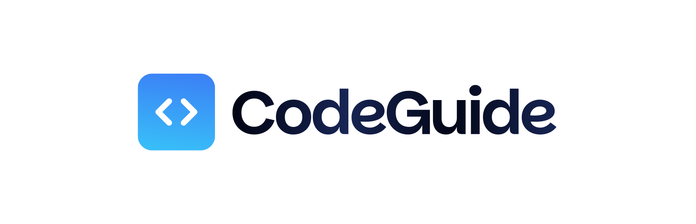

[](https://codeguide.dev)

# CodeGuide Starter Kit

A modern web application starter template built with Next.js 15, featuring authentication, database integration, AI capabilities, and dark mode support.

## Tech Stack

- **Framework:** [Next.js 15](https://nextjs.org/) (App Router)
- **Language:** TypeScript
- **Authentication:** [Clerk](https://clerk.com/)
- **Database:** [Supabase](https://supabase.com/)
- **Styling:** [Tailwind CSS v4](https://tailwindcss.com/)
- **UI Components:** [shadcn/ui](https://ui.shadcn.com/)
- **AI Integration:** [Vercel AI SDK](https://sdk.vercel.ai/)
- **Theme System:** [next-themes](https://github.com/pacocoursey/next-themes)

## Prerequisites

Before you begin, ensure you have the following:
- Node.js 18+ installed
- A [Clerk](https://clerk.com/) account for authentication
- A [Supabase](https://supabase.com/) account for database
- Optional: [OpenAI](https://platform.openai.com/) or [Anthropic](https://console.anthropic.com/) API key for AI features
- Generated project documents from [CodeGuide](https://codeguide.dev/) for best development experience

## Getting Started

1. **Clone the repository**
   ```bash
   git clone <repository-url>
   cd codeguide-starter-kit
   ```

2. **Install dependencies**
   ```bash
   npm install
   # or
   yarn install
   # or
   pnpm install
   ```

3. **Environment Variables Setup**
   - Copy the `.env.example` file to `.env.local`:
     ```bash
     cp .env.example .env.local
     ```
   - Fill in the environment variables in `.env.local` (see Configuration section below)

4. **Start the development server**
   ```bash
   npm run dev
   # or
   yarn dev
   # or
   pnpm dev
   ```

5. **Open [http://localhost:3000](http://localhost:3000) with your browser to see the result.**

The homepage includes a setup dashboard with direct links to configure each service.

## Configuration

### Clerk Setup
1. Go to [Clerk Dashboard](https://dashboard.clerk.com/)
2. Create a new application
3. Go to API Keys
4. Copy the `NEXT_PUBLIC_CLERK_PUBLISHABLE_KEY` and `CLERK_SECRET_KEY`

### Supabase Setup
1. Go to [Supabase Dashboard](https://supabase.com/dashboard)
2. Create a new project
3. Go to Authentication → Integrations → Add Clerk (for third-party auth)
4. Go to Project Settings > API
5. Copy the `Project URL` as `NEXT_PUBLIC_SUPABASE_URL`
6. Copy the `anon` public key as `NEXT_PUBLIC_SUPABASE_ANON_KEY`

### AI Integration Setup (Optional)
1. Go to [OpenAI Platform](https://platform.openai.com/) or [Anthropic Console](https://console.anthropic.com/)
2. Create an API key
3. Add to your environment variables

## Environment Variables

Create a `.env.local` file in the root directory with the following variables:

```env
# Clerk Authentication
NEXT_PUBLIC_CLERK_PUBLISHABLE_KEY=your_publishable_key
CLERK_SECRET_KEY=your_secret_key

# Supabase
NEXT_PUBLIC_SUPABASE_URL=your_supabase_url
NEXT_PUBLIC_SUPABASE_ANON_KEY=your_supabase_anon_key

# AI Integration (Optional)
OPENAI_API_KEY=your_openai_api_key
ANTHROPIC_API_KEY=your_anthropic_api_key
```

## Features

- 🔐 Authentication with Clerk (middleware protection)
- 🗄️ Supabase Database with third-party auth integration
- 🤖 AI Chat Interface with OpenAI/Anthropic support
- 🎨 40+ shadcn/ui components (New York style)
- 🌙 Dark mode with system preference detection
- 🎯 Built-in setup dashboard with service status
- 🚀 App Router with Server Components
- 🔒 Row Level Security examples with Clerk user IDs
- 📱 Responsive design with TailwindCSS v4
- 🎨 Custom fonts (Geist Sans, Geist Mono, Parkinsans)

## Project Structure

```
codeguide-starter-kit/
├── src/
│   ├── app/                    # Next.js app router pages
│   │   ├── api/chat/          # AI chat API endpoint
│   │   ├── globals.css        # Global styles with dark mode
│   │   ├── layout.tsx         # Root layout with providers
│   │   └── page.tsx           # Hero + setup dashboard
│   ├── components/            # React components
│   │   ├── ui/                # shadcn/ui components (40+)
│   │   ├── chat.tsx           # AI chat interface
│   │   ├── theme-provider.tsx # Theme context
│   │   └── theme-toggle.tsx   # Dark mode toggle
│   ├── lib/                   # Utility functions
│   │   ├── supabase.ts        # Supabase client with Clerk auth
│   │   ├── user.ts            # User utilities
│   │   ├── utils.ts           # General utilities
│   │   └── env-check.ts       # Environment validation
│   └── middleware.ts          # Clerk route protection
├── supabase/
│   └── migrations/            # Database migrations with RLS examples
├── CLAUDE.md                  # AI coding agent documentation
├── SUPABASE_CLERK_SETUP.md   # Integration setup guide
└── components.json            # shadcn/ui configuration
```

## Database Integration

This starter includes modern Clerk + Supabase integration:

- **Third-party auth** (not deprecated JWT templates)
- **Row Level Security** policies using `auth.jwt() ->> 'sub'` for Clerk user IDs
- **Example migrations** with various RLS patterns (user-owned, public/private, collaboration)
- **Server-side client** with automatic Clerk token handling

Pull requests that change SQL in `supabase/migrations` run [RattleCheck](.github/workflows/rattlecheck.yml). It flags new high or critical permission findings at the migration line. The check runs on committed SQL and needs no Clerk or Supabase credentials.

## AI Coding Agent Integration

This starter is optimized for AI coding agents:

- **`CLAUDE.md`** - Comprehensive project context and patterns
- **Setup guides** with detailed integration steps
- **Example migrations** with RLS policy templates
- **Clear file structure** and naming conventions
- **TypeScript integration** with proper type definitions

## Documentation Setup

To implement the generated documentation from CodeGuide:

1. Create a `documentation` folder in the root directory:
   ```bash
   mkdir documentation
   ```

2. Place all generated markdown files from CodeGuide in this directory:
   ```bash
   # Example structure
   documentation/
   ├── project_requirements_document.md             
   ├── app_flow_document.md
   ├── frontend_guideline_document.md
   └── backend_structure_document.md
   ```

3. These documentation files will be automatically tracked by git and can be used as a reference for your project's features and implementation details.

## Contributing

Contributions are welcome! Please feel free to submit a Pull Request.